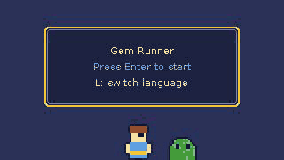

# Gem Runner: a complete sample game built with gst (Godot 4.7)

A small 2D action-platformer: three levels, a player and slime enemies built from
Aseprite files, patrols that follow a navmesh, a gem pickup on each level that unlocks
the exit door, a title screen, a win screen, a HUD, two locales (English, German),
looping music and generated sound effects.

Every generated asset is produced by a `gst` command in [`build.sh`](build.sh).
The art is drawn either by the kit's own generators (`tex-gen`, `sfx-gen`,
`bmfont-gen`) or by the small procedural scripts in `src/`. The music is the kit
sample `samples/loops/song_loop.wav` (copied to `data/song_loop.wav` so the example builds from the tarball, which leaves `samples/` out). Nothing is downloaded or hand-drawn.



## Usage

```bash
export GODOT_BIN=/path/to/Godot_v4.7.2-stable_linux.x86_64   # only needed for --verify / --movie
bash build.sh            # rebuild every generated asset (about 20 s, CPU only)
bash build.sh --verify   # + headless import (must be error-free) + autoplay to the win screen
bash build.sh --movie    # + verify + software-GL --write-movie capture -> media/gameplay.{gif,mp4}

"$GODOT_BIN" --path project                                   # play: arrows to move, Enter/Space/Up to jump, L switches language
"$GODOT_BIN" --headless --path project --fixed-fps 60 -- --autoplay          # scripted run, about 2 s
"$GODOT_BIN" --headless --path project --fixed-fps 60 -- --autoplay --locale=de
```

The autoplay run prints `SAMPLE_GAME_*` markers: `BOOT` (translations and the
enemy table loaded), `LEVEL n`, `NAV_OK` (an enemy got a navmesh path), `GEM`,
`STOMP`, `Ln_OK`, `WIN` and `DONE`. It exits with code 0 on the win screen, or 1
on a timeout. The movie run renders 24.9 s at 30 fps under llvmpipe. Godot quits
on the win screen, before the 26 s `--quit-after` cap.

## Layout

| Path | What |
|---|---|
| `build.sh` | The asset pipeline. It wipes and rewrites `project/{art,levels,ui,audio,data,i18n}` and `work/`. |
| `src/make_ase.py` | Writes binary `.aseprite` files: a 16×24 player with 9 frames and tags `idle` (ping-pong), `run`, `jump`, `fall`, `hurt`; and a 16×16 slime with 5 frames and tags `walk` (ping-pong), `hurt`. |
| `src/make_tiles.py` | Draws the pieces `tex-gen` can't: an asymmetric grass edge (so flips are visible), 4 gem frames, a two-tile door, a torch, and a 24×24 UI panel. |
| `src/bake_levels.py` | The level design. It places GIDs (with Tiled H/V/diagonal flip bits) on `map-blank` output and adds a hidden `navstrip` layer and an object layer. It also writes gap data for `jump-arc`. |
| `data/enemies.csv` | Enemy stats table: speed, hp, damage, stomp bounce, tint. |
| `data/loc.csv` | Strings in `en` and `de`. |
| `data/import_rules.json` | Rules for `godot-import-presets`. |
| `data/song_loop.wav`, `data/fonts/` | A copy of the kit sample song, and the kit's DejaVu Sans subset with its licence. |
| `project/` | The Godot project. `project.godot`, `scenes/` and `scripts/` are authored; the rest is generated. |
| `media/` | `gameplay.gif` (320×180, 10 fps), `gameplay.mp4` (640×360, 30 fps, with audio) and four `shot_*.png` stills from `build.sh --movie`. |

## Walkthrough: which gst command made each asset

| Asset (under `project/`) | Produced by |
|---|---|
| `art/tiles.png` (12 tiles, 4 columns) + `art/tiles.json` | `gst tex-gen noise` (grass, dirt), `gst tex-gen bricks`, `gst tex-gen planks`, and `src/make_tiles.py` pieces, packed by `gst frames-to-sheet --columns 4 --no-crop` |
| `levels/levelN.json` (Tiled JSON, 50×12) | `gst map-blank --layers ground,platforms,navstrip`, then `src/bake_levels.py`. Each gap is checked with `gst jump-arc` using the game's physics (gravity 900, jump 320, speed 110). |
| `levels/levelN_tiles.tscn` + `levels/levelN_tileset.tres` | `gst map-to-godot --write-tileset --res res://art/`. Flipped GIDs become TileSet alternative tiles (`flip_h`, `flip_v`, `transpose`). Levels 1, 2 and 3 have 3, 5 and 14 flipped cells. The hidden `navstrip` layer stays `visible = false`. |
| `levels/levelN_solid.tscn` | `gst tile-colliders --layer ground`, then `gst tile-colliders-to-godot` (merged StaticBody2D rectangles) |
| `levels/levelN_oneway.tscn` | `gst tile-colliders --layer platforms`, then `gst tile-colliders-to-godot`. `level.gd` sets `one_way_collision`. |
| `levels/levelN_nav.tscn` | `gst nav-to-godot --solid-layer ground --ground-layer navstrip` (NavigationRegion2D strips above each floor) |
| `levels/levelN_objects.tscn` | `gst map-objects-to-godot --res res://art/`. It produces a spawn Marker2D, enemy markers (`kind`/`patrol` metadata), patrol polylines (Line2D + segment shape), the gem as an AnimatedSprite2D (from the Tiled tile animation), door Sprite2Ds and an `exit` Area2D. |
| `art/player.tres`, `art/slime.tres` + `art/*_frames/frame_NNNN.png` | `gst ase-to-godot --res res://art/<name>_frames` (tags become SpriteFrames animations; ping-pong is expanded; frame durations are kept). `gst ase-decode` writes the tag report to `work/`. |
| `art/player_hitbox.tscn`, `art/slime_hitbox.tscn` | `gst hitbox-gen --pad 0` on the exported frames, then `gst hitbox-to-godot --shape aabb` (one Area2D per frame; the player enables the one matching its current frame) |
| `ui/panel.png` | `src/make_tiles.py`. Previewed at three sizes with `gst nine-slice --preview`. |
| `ui/panel.tres` (StyleBoxTexture) | `gst nine-slice-to-godot --insets 6,6,6,6` |
| `ui/font.fnt` + `ui/font.png` | `gst bmfont-gen --size 11 --no-aa` from the kit's DejaVu Sans subset. Coverage of every string is gated by `gst font-check --font work/font.fnt data/loc.csv`. |
| `ui/theme.tres` | `gst font-to-godot --copy-dir project/ui` |
| `i18n/strings.en.translation`, `i18n/strings.de.translation` | `gst loc-check`, then `gst loc-to-godot --langs en,de --translation-dir` (official Godot `.translation` files; registered in `project.godot`) |
| `data/enemies.tres` + `data/enemies.gd` | `gst data-to-godot` (a typed Resource that `game.gd` reads into `Game.stats`) |
| `audio/music.wav` | The kit sample `song_loop.wav`. `gst loop-finder --json` finds a 6.0 s loop; `gst wav-loop-meta from-json` embeds it as a `smpl` chunk; `gst wav-loop-meta show` reports it. |
| `audio/sfx/jump.wav`, `audio/sfx/coin.wav`, `audio/sfx/hit.wav` | `gst sfx-gen jump/coin/hit --seed 7`, then `gst sfx-normalize --peak -3` |
| `*.import` files | `gst godot-import-presets -r data/import_rules.json --force`: `pixel` for art and UI; `wav-loop` for the music, which honours the embedded loop points in 2.4.0 |
| `work/preview/*` | `gst tile-preview --objects` (level PNGs), `gst frames-to-sheet` + `gst spritesheet-gif` (sprite sheets), `gst nine-slice --preview` |
| `media/gameplay.gif` | The Godot `--write-movie` AVI goes through ffmpeg to 10 fps frames, then `gst frames-to-sheet`, `gst spritesheet-gif` and `gst gif-optimize --colors 64` |

## Gameplay code (authored)

- `scripts/game.gd` (autoload): level index, hearts, gems, the enemy table, locale, autoplay and timeout.
- `scripts/level.gd`: instances the five generated scenes for the current level. It spawns the player and the enemies from object metadata, wires the gem and exit areas, and runs the HUD (nine-slice panel, bitmap font, `tr()` text).
- `scripts/player.gd`: run and jump physics matching `jump-arc`, animation state from the Aseprite tags, per-frame hurtboxes, stomp vs. hurt, and the autoplay controller (jumps at walls, gaps and enemies).
- `scripts/enemy.gd`: stats from `enemies.tres`. It patrols between the ends of its Tiled patrol polyline by following `NavigationServer2D.map_get_path` over the nav-to-godot region.
- `scripts/title.gd`, `scripts/win.gd`: menu screens (autoplay shows both locales on the title).

## Kit bugs found while building this (fixed in 2.4.0)

1. `godot-import-presets`: the `wav-loop` preset forced loop mode *Forward* over the whole file, discarding the `smpl` loop points written by `wav-loop-meta`. `wav-oneshot` used *Detect*, so a one-shot with a `smpl` chunk would loop. It now uses *Detect* when a `smpl` loop is present, *Forward* otherwise, and *Disabled* for one-shots. Regression tests: `tests/test_v24.py::test_wav_loop_preset_*`, including a Godot check.
2. `ase-to-godot`: without `--res`, the frame textures were written as `res://frame_NNNN.png`, although the PNGs go to `<out>_frames/`. The `res://` folder is now derived from the nearest `project.godot`. Regression test: `tests/test_v24.py::test_ase_to_godot_default_res_follows_frames_folder`.

## Known gaps

- The bitmap font is the kit's 95-glyph ASCII DejaVu subset, so the German strings are written without umlauts ("druecken", "Gruener"). `font-check` gates this.
- Levels are fixed designs (`src/bake_levels.py`), not generated, and enemies have no attack beyond contact.
- The autoplay controller is tuned to these three layouts; it is a test driver, not general AI.
- `--write-movie` captures the 320×180 viewport; the MP4 is scaled 2× (nearest) by ffmpeg.

## Source and licence

Part of gamestudio-tools. All code, levels and art in this folder were written
for the kit; the music is the kit's own `samples/loops/song_loop.wav`. The bitmap font
is baked from `data/fonts/DejaVuSans-subset.ttf`, a copy of the kit's test fixture (DejaVu fonts licence, see
`data/fonts/DejaVuSans-LICENSE.txt`). The project licence is MIT; see
LICENSE (Copyright 2026 Jordan Newman / OmniSpace Technologies LLC).
