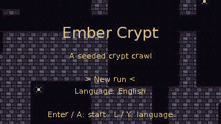

# Ember Crypt: top-down roguelite sample (Godot 4.7.2)

A complete small game built with gamestudio-tools: two procedurally generated
dungeon floors and a boss arena, an autotiled 47-tile blob tileset, five enemy
kinds with three behaviours (chase, shoot, boss), pickups and loot tables, a HUD,
12 sound effects and a looping music track, save/load between floors, English,
German and French text, and keyboard plus gamepad input. Every file under
`project/art`, `levels`, `ui`, `audio`, `data` and `i18n` is written by a `gst`
command in `build.sh` (86 different tools, 61 of them not used by
`examples/sample-game-full`). The authored inputs are small Python drawing and
placement scripts, CSV/JSON tables, the DejaVu Sans font and the GDScript game code.



`media/gameplay.gif` shows 35 s of highlights at 5 fps; `media/gameplay.mp4` is
the full 74 s autoplay run with sound, captured with Godot's `--write-movie`. Stills: `media/shot_title.png`, `shot_floor1.png`,
`shot_floor2.png`, `shot_boss.png` and `shot_win.png`.

## Usage

```bash
cd examples/sample-topdown
bash build.sh                       # regenerate every asset (about 35 s, CPU only)
GODOT_BIN=/path/to/Godot_v4.7.2 bash build.sh --verify   # + import, autoplay clear, save-file lint
GODOT_BIN=/path/to/Godot_v4.7.2 bash build.sh --movie    # + software-GL movie -> media/
SEED=9 bash build.sh                # another dungeon (the floors use SEED*100+1 and SEED*100+2)
```

Play it: open `project/` in Godot 4.7 and press F5. Keys: WASD or arrows to move,
J or Space to attack, Enter or K to confirm, L to switch the language, Esc or P to
pause. Gamepad: left stick or D-pad to move, X or RB to attack, A to confirm, Y for
the language, Start to pause. The title menu offers Continue when a save exists.

Command-line switches (after `--`): `--autoplay` (scripted run), `--locale=de`,
`--save=user://other.json`, `--timeout=SECONDS`.

`build.sh` needs `gst` (run from a checkout, an installed kit, or with `GST_ROOT`).
The Godot steps run headless with an isolated HOME; the movie step also needs
`xvfb-run` and `ffmpeg`.

## Layout

```
build.sh                 the whole asset pipeline (wipes and regenerates project/ assets and work/)
src/make_art.py          procedural pixel drawings: raw actor, boss, pickup, slash, prop and panel frames
src/blob_rules.py        turns tileset-gen's 256-entry blob lookup into a map-auto-layer rule table
src/compose.py           places spawn, key, stairs, enemies and pickups in dungeon-gen's rooms (seeded)
src/make_music.py        the music score as an sfx-mix recipe (8 bars, 120 bpm, 16 s)
data/                    loc.csv, enemies.csv, items.csv, loot.json, schema.json, save_schema.json,
                         floor_rules.json, map_props.schema.json, level_budget.json, roar_recipe.json,
                         import_rules.json, fonts/DejaVuSans.ttf (+ licence)
project/                 the Godot project: project.godot, scenes/, scripts/ (authored) + generated assets
work/                    intermediates, reports and previews (gitignored, rebuilt by build.sh)
media/                   GIF, MP4 and stills from build.sh --movie
```

## Walkthrough: which gst command made each asset

| Generated file(s) | Made by |
|---|---|
| `art/walls.png`, `art/walls.json` (47-tile blob sheet + 256-entry lookup) | `gst tex-gen bricks` (wall) and `gst tex-gen noise` (floor) -> `gst tileset-gen --border 3 --edge-color`; checked with `gst tile-dedupe` |
| `art/props.png`, `art/props.json` (floor, shadow, stairs, rune) | `gst lut-tool make` + `gst lut-tool apply` (shadow tile) -> `gst frames-to-sheet` |
| `levels/floor1.json`, `levels/floor2.json` (`levels/floorN.json`) | `gst dungeon-gen --mode bsp --seed SEED*100+N` -> `gst map-auto-layer` twice (blob walls, then floor/shadow/rune rules) -> `src/compose.py` (objects) |
| `levels/boss.json` | `gst map-blank` -> `gst map-fill` (walls, then the floor rect) -> `gst map-stamp` x4 (2x2 pillars) -> `gst map-auto-layer` -> `src/compose.py --mode boss` |
| level checks (work/reports) | `gst map-path --fail-if-none` (spawn->key, key->stairs), `gst map-reach --require`, `gst tmx-props-lint`, `gst level-budget --fail-on-under`, `gst tilemap-stats --fail-on-empty-layer`, `gst tmx-objects-csv`, `gst tmx-gid-usage --fail-on-unused-tileset` |
| `levels/LEVEL_tiles.tscn`, `levels/LEVEL_tileset.tres` | `gst map-to-godot --write-tileset` (TileMapLayer per layer, two atlases) |
| `levels/LEVEL_solid.tscn` | `gst tile-colliders --layer walls` -> `gst tile-colliders-to-godot` |
| `levels/LEVEL_nav.tscn` | `gst nav-to-godot --solid-layer walls` (NavigationRegion2D used by the enemies and the autoplay) |
| `levels/LEVEL_objects.tscn` | `gst map-objects-to-godot` (Marker2D with `tiled_type`/`kind` metadata; stairs as a tile Sprite2D) |
| `art/actors.png`, `art/actors.json` | `src/make_art.py` frames -> `gst team-outline --team red` (bat_red) and `gst palette-swap --hue 180` (warlock) -> `gst asset-rename run --replace --apply` -> `gst sprite-scale --scale 2` (boss) -> `gst palette-apply --palette pico8` -> `gst sprite-outline-gen` -> `gst sprite-shadow --mode contact` -> `gst atlas-pack`; checked with `gst atlas-validate`, `gst pixel-lint` |
| `art/actors_frames.tres` (15 animations) | `gst anim-from-folder --fps 'player-walk-*=10,boss-charge=12' --once 'player-idle-*'` -> `gst atlas-to-godot --clips`; timings checked with `gst frame-timing-check --strict` |
| `art/actors_hitboxes.tscn` | `gst hitbox-gen --atlas` -> `gst hitbox-to-godot --shape aabb` (the player's hurt radius) |
| `art/slash.png`, `art/slash.json`, `art/slash_frames.tres` | `gst palette-apply` -> `gst sprite-angles --angles 8` -> `gst atlas-to-godot --per-frame` |
| `art/pickups.png`, `art/pickups.json`, `art/pickups_frames.tres` | `gst palette-apply` -> `gst sprite-outline-gen` -> `gst anim-from-folder` -> `gst atlas-pack` -> `gst atlas-validate` -> `gst atlas-to-godot` |
| `ui/icons/heart-idle_0.png`, `ui/icons/coin-spin_0.png`, `ui/icons/key-idle_0.png` | `gst atlas-unpack --untrim` of the pickups atlas |
| `art/portal.png` | `gst sprite-scale --scale 2` + `gst palette-swap --hue 200` of the rune prop |
| `art/title_bg.png` | `gst tile-preview` of floor 1 (no object overlay) -> `gst sprite-canvas --size 320x180` -> `gst lut-tool` (darken, desaturate) |
| `art/icon.png` | `gst sprite-scale --size 1024x1024` -> `gst icon-gen` (web/iOS/Android/desktop set; the 192 px web icon is used) |
| `ui/ember11.fnt`, `ui/ember11.png`, `ui/ember22.fnt`, `ui/ember22.png` | `gst font-subset` (DejaVu Sans, 3 % of the file) -> `gst bmfont-gen` (11 px 1-bit, 22 px); `gst font-check`, `gst font-preview` |
| `ui/ember11_theme.tres`, `ui/ember22_theme.tres` | `gst font-to-godot` |
| `ui/panel.png`, `ui/panel_style.tres` | `src/make_art.py` panel -> `gst nine-slice` preview -> `gst nine-slice-to-godot` |
| `i18n/loc.en.translation`, `i18n/loc.de.translation`, `i18n/loc.fr.translation` | `data/loc.csv` checked by `gst loc-check`, `gst loc-key-lint`, `gst loc-placeholder-lint`, `gst loc-stats`, `gst loc-fit` (also on `gst pseudoloc` output) -> `gst loc-to-godot` |
| `data/enemies.tres`, `data/enemies.gd` | `gst game-data-lint --strict` -> `gst data-to-godot` |
| `data/loot.json` | copy of `data/loot.json`, simulated with `gst drop-sim --expect` (the game rolls the same tables) |
| `audio/sfx/swing.wav` | `gst sfx-gen laser` -> `gst sfx-pitch -5` -> `gst sfx-envelope` |
| `audio/sfx/hit_0.wav`, `hit_1.wav`, `hit_2.wav` | `gst sfx-gen hit` -> `gst sfx-variants -n 3` |
| `audio/sfx/hurt.wav` | `gst sfx-pitch -6` of the hit |
| `audio/sfx/stairs.wav` | `gst sfx-reverse` of `gst sfx-gen powerup` |
| `audio/sfx/roar.wav` | `gst sfx-mix data/roar_recipe.json` (pitched explosion + lasers) |
| `audio/sfx/coin.wav`, `pickup.wav`, `shoot.wav`, `death.wav`, `blip.wav` | `gst sfx-gen` coin, powerup, laser, explosion, blip |
| all `audio/sfx/*.wav` | `gst sfx-normalize --peak -3`; reports from `gst wav-batch-meta`, `gst cue-sheet`, `gst sfx-bank pack` |
| `audio/music.wav` (16 s seamless loop) | kick: `gst sfx-pitch` + `gst wav-loop-snap --no-meta` + `gst wav-fade`; hat: `gst sfx-pitch`; `src/make_music.py` recipe -> `gst sfx-mix` -> `gst wav-loud-apply --target -16` -> `gst wav-loop-snap` (writes the smpl loop) -> `gst wav-loop-meta show`; `gst sfx-spectrogram` preview |
| `*.import` | `gst godot-import-presets -r data/import_rules.json` (pixel textures, music as wav-loop) |
| project audits | `gst input-map-lint --scan scripts --parity --strict` (every action has keyboard and gamepad), `gst godot-res-lint --strict`, `gst asset-unused --strict`, `gst texture-budget`, `gst asset-manifest build` |
| previews (work/preview) | `gst palette-extract`, `gst colorblind-sim sim`, `gst onion-skin`, `gst contact-sheet`, `gst spritesheet-gif`, `gst tile-preview` |
| `media/gameplay.gif`, `media/gameplay.mp4`, `media/shot_*.png` | Godot `--write-movie` -> ffmpeg -> `gst frames-to-sheet` -> `gst spritesheet-gif` -> `gst gif-optimize` |
| save file check | the save the autoplay wrote is linted with `gst game-data-lint data/save_schema.json --strict` |

## Gameplay code (authored)

`project/scripts/`: `game.gd` (autoload: run state, data tables, loot rolls with
drop-sim semantics, save/load to `user://ember_save.json` as a one-row JSON table,
audio, locale), `level.gd` (assembles the generated scenes, spawns actors at the
markers, stairs locked until the key, boss portal), `player.gd` (input map
movement, 8-way slash, i-frames, and the autoplay pilot that presses the same
actions), `enemy.gd` (chase via NavigationServer2D paths; shoot with line of
sight and spacing; boss chase -> telegraph -> charge -> 8-way burst), `projectile.gd`,
`pickup.gd`, `hud.gd`, `title.gd`, `win.gd`. Every floor transition saves, then the
next floor is started by loading that save, so the autoplay covers both paths.

The autoplay (`--autoplay`) cycles the title through de/fr/en with the real L key
event, checks that keyboard, gamepad button and stick events reach the input map,
starts with the gamepad A button, then clears both floors and the boss. With
`--fixed-fps 60` and synchronous navigation updates the run is identical every
time (seed 7: 12 coins, 68.4 s of game time).

## Kit bugs found while building this (fixed in 2.5.0)

1. `dungeon-gen` JSON had an empty tileset, so `map-to-godot` drew nothing and
   `map-reach`/`nav-to-godot` saw an all-walkable map. It now embeds a 2-tile
   tileset (wall tile `solid=true`), layer ids, and a `rooms` object layer.
2. `atlas-to-godot` dropped atlas-pack's trim data, so trimmed frames shrank and
   jittered. AtlasTextures now carry `margin` from `spriteSourceSize`/`sourceSize`.
3. `anim-from-folder --fps` took only exact names and only the last flag; glob
   keys (`walk-*=10`) and repeated `--fps`/`--once` now work.
4. `asset-unused` ignored `project.godot` (icon, autoloads, translations, main
   scene) and BMFont `.fnt` page images, and listed `project.godot` itself.
5. `nav-to-godot` wrote one rectangle per polygon with private vertices; Godot only
   links polygons across identical edges, so rooms touching at T-junctions were
   islands and `map_get_path` returned nothing. Vertices are now shared and
   T-junctions split.

## Known gaps

- The boss arena is fixed (map-blank + pillars); only the two floors are procedural.
- The autoplay pilot is tuned for seed 7; other seeds build and validate
  (paths, reachability, budget) but the scripted run is only checked for seed 7.
- `asset-unused` cannot see paths built at run time; `game.gd` lists its sound
  paths literally for that reason.
- `pixel-lint` warns about the semi-transparent contact shadows on purpose.
- The movie is rendered with llvmpipe software GL, so it takes about a minute.

## Source and licence

Part of gamestudio-tools. All code, levels, art, sound and music in this folder
were written or generated for the kit. `data/fonts/DejaVuSans.ttf` is DejaVu Sans
2.37 (Bitstream Vera derived, free licence in `data/fonts/DejaVuSans-LICENSE.txt`);
the game ships only the subset that `gst font-subset` cuts from it. The project
licence is MIT; see LICENSE (Copyright 2026 Jordan Newman / OmniSpace Technologies LLC).
