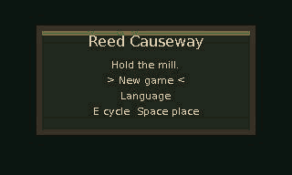

# Reed Causeway: tower defense sample (Godot 4.7.2)

A complete small game built with gamestudio-tools: a 20×12 marsh, a one-tile causeway,
three tower kinds, four waves, a HUD, eight sound effects and a looping music track,
English, German and French text, and keyboard plus gamepad input. Every file under
`project/art`, `levels`, `ui`, `audio`, `data` and `i18n` is written by `build.sh`.
`build.sh` runs 120 different `gst` tools, 52 of them not used by
`examples/sample-topdown` or `examples/sample-game-full`. The authored inputs are
small Python drawing and placement scripts, CSV/JSON tables, a short Yarn briefing,
the DejaVu Sans font and the GDScript game code.



`media/gameplay.gif` is the 28 s seeded autoplay, sampled at 6 fps. Stills:
`media/shot_title.png`, `shot_wave.png`, `shot_fight.png` and `shot_win.png`.

## Usage

```bash
cd examples/sample-towerdefense
bash build.sh                       # regenerate every asset (CPU only)
GODOT_BIN=/path/to/Godot_v4.7.2 bash build.sh --verify   # + import, autoplay win, save-file lint
GODOT_BIN=/path/to/Godot_v4.7.2 bash build.sh --movie    # + software-GL movie -> media/
```

Play it: open `project/` in Godot 4.7 and press F5. Click a grass tile, or press
Space or J, to place the selected tower. E cycles the tower (arrow, frost, mortar).
Enter confirms the title menu. L switches the language. Esc or P pauses. Gamepad:
A confirms, X places, RB cycles, Y switches the language, Start pauses.

Command-line switches (after `--`): `--autoplay` (scripted run), `--locale=de`,
`--save=user://other.json`, `--timeout=SECONDS`.

`build.sh` needs `gst` (run from a checkout, an installed kit, or with `GST_ROOT`).
The Godot steps run headless with an isolated HOME; the movie step also needs
`xvfb-run` and `ffmpeg`.

## Layout

```
build.sh                 the whole asset pipeline (wipes and regenerates project/ assets and work/)
src/make_art.py          procedural drawings: mill tile, tower layers, creeps, puff, panel, parallax, wfc csv
src/layout.py            checks the painted path, writes the mill tile and the object layer
src/sim.py               the same combat step the game runs; writes data/combat.json
src/make_music.py        the music score as an sfx-mix recipe (4 bars, 120 bpm)
data/                    loc.csv, towers/creeps/waves/build.csv, schemas, briefing.yarn, credits.txt,
                         fonts/DejaVuSans.ttf (+ licence)
project/                 the Godot project: project.godot, scenes/, scripts/ (authored) + generated assets
work/                    intermediates, reports and previews (gitignored, rebuilt by build.sh)
media/                   GIF and stills from build.sh --movie
```

## Walkthrough: which gst command made each asset

| Generated file(s) | Made by |
|---|---|
| `art/tiles.png`, `art/tiles.json` (grass, path, water, mill) | `gst tex-gen noise` (grass, water) and `gst tex-gen bricks` (path); the mill is drawn; `gst frames-to-sheet --columns 4` |
| work-only tile experiments | `gst autotile-gen`, `gst tileset-wang`, `gst tile-extrude`, `gst wfc-tiles`, `gst godot-tileset` (the shipped tileset is `gst map-to-godot --write-tileset`) |
| `levels/causeway.json` | `gst map-blank` -> twelve `gst map-fill` rects (grass, water, road) -> `src/layout.py` (mill gid, objects) |
| route and combat | `gst curve-gen --kind linear` writes `data/route.json`; `gst curve-trace` previews it; `src/sim.py` writes `data/combat.json` and `data/rules.json` is the authored rules copied in |
| level checks (work/reports) | `gst map-path --fail-if-none`, `gst map-reach --require`, `gst tmx-props-lint`, `gst level-budget --fail-on-under`, `gst tilemap-stats --fail-on-empty-layer`, `gst tmx-objects-csv`, `gst tmx-gid-usage --fail-on-unused-tileset`, `gst tmx-tileset-list`, `gst tilemap-convert`, `gst room-graph --fail-on-unreachable`, `gst nav-grid`, `gst map-outline` |
| work-only map experiments | `gst map-layer-rename`, `gst map-pad`, `gst map-diff` (against the shipped map), `gst level-curve`, `gst data-diff`, `gst prefab-index` |
| `levels/causeway_tiles.tscn`, `levels/causeway_tileset.tres` | `gst map-to-godot --write-tileset` |
| `levels/causeway_solid.tscn` | `gst tile-colliders --solid 3` (water) -> `gst tile-colliders-to-godot`; `gst collider-preview` |
| `levels/causeway_nav.tscn` | `gst nav-to-godot --ground-layer path --no-colliders` |
| `levels/causeway_objects.tscn` | `gst map-objects-to-godot` (hidden at runtime; the road is the path tiles); `gst tile-preview` |
| `art/towers.png`, `art/towers.json`, `art/towers_frames.tres` | drawn layers -> `gst sprite-stack` -> `gst sprite-outline-gen` -> `gst sprite-shadow` -> `gst alpha-bleed` -> `gst atlas-pack` -> `gst atlas-validate` -> `gst atlas-to-godot --per-frame` |
| `art/icon.png` | `gst sprite-scale --size 1024x1024` -> `gst icon-gen` (the 192 px web icon) |
| `art/creeps/grub_0.png`, `grub_1.png`, `grub_2.png`, `grub_3.png`, `runner_0.png`, `runner_1.png`, `runner_2.png`, `runner_3.png`, `brute_0.png`, `brute_1.png`, `brute_2.png`, `brute_3.png`, `art/creeps_frames.tres` | grub drawn, runner is `gst sprite-recolor` then `gst asset-rename run --replace --apply`; brute drawn; `gst sprite-outline-gen` -> `gst sprite-shadow` -> `gst alpha-bleed` -> `gst anim-from-folder` -> `gst anim-pingpong` -> `gst anim-retarget-fps` -> `gst anim-to-godot`; `gst pixel-lint`, `gst frame-timing-check --strict` |
| `art/puff/puff_0.png`, `puff_1.png`, `puff_2.png`, `puff_3.png`, `art/puff_frames.tres` | drawn frames -> `gst anim-from-folder --once puff` -> `gst anim-to-godot`; `gst anim-hold` is work-only |
| `art/title_bg.png` | `gst parallax-preview --png` (sky, hills, reeds). `gst particle-preview` and `gst gif-to-frames` stay in work/ |
| `ui/panel.png`, `ui/panel_style.tres` | drawn panel -> `gst nine-slice` -> `gst nine-slice-to-godot` |
| `ui/reed11.fnt`, `ui/reed11.png`, `ui/reed16.fnt`, `ui/reed16.png`, `ui/reed11_theme.tres`, `ui/reed16_theme.tres` | `gst font-subset` -> `gst bmfont-gen` (11 px and 16 px); `gst font-check`, `gst font-preview`, `gst font-to-godot` |
| `i18n/loc.en.translation`, `i18n/loc.de.translation`, `i18n/loc.fr.translation` | `data/loc.csv` through `gst loc-check`, `gst loc-key-lint`, `gst loc-placeholder-lint`, `gst loc-stats`, `gst loc-sort`, `gst loc-split`, `gst loc-join`, `gst loc-missing`, `gst loc-plurals`, `gst loc-fill`, `gst pseudoloc`, `gst loc-fit`, `gst text-wrap-bake` -> `gst loc-to-godot` |
| dialogue and credits (work/) | `gst dialogue-lint`, `gst dialogue-extract`, `gst dialogue-stats`, `gst dialogue-graph`, `gst dialogue-to-yarn`, `gst credits-roll` |
| `data/towers.tres`, `data/towers.gd`, `data/creeps.tres`, `data/creeps.gd`, `data/waves.tres`, `data/waves.gd`, `data/build.tres`, `data/build.gd` | `gst game-data-lint --strict` -> `gst data-to-godot` |
| `audio/sfx/blip.wav`, `place.wav`, `shoot.wav`, `hit.wav`, `death.wav`, `win.wav`, `leak.wav`, `wave.wav` | `gst sfx-gen` -> `gst wav-dc-remove` -> `gst wav-trim` -> `gst wav-mono` -> `gst wav-resample` -> `gst wav-fade` -> `gst sfx-pitch` -> `gst wav-gain` -> `gst wav-limit` -> `gst sfx-normalize --peak -3` |
| `audio/music.wav` (8 s seamless loop) | kick and hat are `gst sfx-pitch` of death and hit; `src/make_music.py` -> `gst sfx-mix` -> `gst wav-loud-apply --target -16` -> `gst loop-xfade` -> `gst wav-loop-snap`; `gst wav-loop-meta show` |
| audio reports | `gst wav-batch-meta`, `gst cue-sheet`, `gst sfx-bank pack`, `gst sfx-spectrogram`, `gst audio-tidy` |
| `*.import` | `gst godot-import-presets -r data/import_rules.json` (pixel textures, music as wav-loop) |
| project audits | `gst input-map-lint --scan scripts --parity --strict`, `gst godot-res-lint --strict`, `gst asset-unused --strict`, `gst texture-budget`, `gst asset-lint`, `gst build-report` |
| previews (work/preview) | `gst palette-extract`, `gst colorblind-sim sim`, `gst onion-skin`, `gst contact-sheet`, `gst frames-to-sheet`, `gst spritesheet-gif` |
| `media/gameplay.gif`, `media/shot_title.png`, `media/shot_wave.png`, `media/shot_fight.png`, `media/shot_win.png` | Godot `--write-movie` -> ffmpeg -> `gst frames-to-sheet` -> `gst spritesheet-gif` -> `gst gif-optimize` |
| manifest | `gst asset-manifest build` |
| save file check | the save the autoplay wrote is linted with `gst game-data-lint data/save_schema.json --strict` |

## Gameplay code (authored)

`project/scripts/`: `game.gd` (autoload: audio, locale, save/load to `user://reed_save.json`
as a one-row JSON table), `level.gd` (places the scripted towers, spawns the waves,
and runs the same fixed `1/60` s combat step as `src/sim.py`), `hud.gd`, `title.gd`,
`win.gd`, `lose.gd`. Creeps walk the `curve-gen` samples in `data/route.json`. The
navmesh is generated and queried once at the start (`NAV_OK`); it does not steer
the creeps. Water colliders are real rectangles and do not affect the creeps.

The autoplay (`--autoplay`) cycles the title through de/fr/en with the real L key,
checks that keyboard and gamepad events reach the input map, starts with the
gamepad A button, then places all eight towers and clears every wave. With
`--fixed-fps 60` the run matches the Python sim (seed 11: 0 leaks, 34 kills,
core 16, gold 199, 1506 frames, 25.1 s).

## Kit bugs found while building this (fixed in 2.6.0)

1. `anim-retarget-fps` only accepted a list of clips. `anim-from-folder`,
   `anim-pingpong` and `anim-meta` write `{"clips": {"walk": {...}}}`. A pipeline
   of those tools exited with "no clips/animations array found". The dict form is
   accepted now, and the new durations are written back onto the same clips.
2. `loc-check` and `loc-placeholder-lint` treated `{# wave}` inside an ICU plural
   branch as a named placeholder, so a correct translation (`{# Welle}`,
   `{# vague}`) failed the lint. `{var, plural|select|selectordinal, ...}` now
   counts as the placeholder `{var}`. `{# words}` is the number plus translated
   text. A real `{name}` nested in a branch is still compared. The helper is
   `lib/icu_text.py`.

## Known gaps

- Creeps follow the baked route, not `NavigationServer2D`. The mesh is queried
  so a broken corner still fails `--verify`.
- The autoplay placements are tuned for seed 11 and the shipped tables.
- `wave_n` is an ICU plural so `loc-plurals` has something to check. The HUD
  uses `hud_wave` with `%d`, because Godot `tr()` does not evaluate ICU.
- The Yarn briefing is linted and graphed; the menus use the loc keys.
- `wfc-tiles`, `tileset-wang`, `autotile-gen`, `tile-extrude` and `godot-tileset`
  run on work copies so they cannot desync the shipped map.
- `pixel-lint` warns about the semi-transparent contact shadows on purpose.
- The movie is rendered with llvmpipe software GL.

## Source and licence

Part of gamestudio-tools. All code, levels, art, sound and music in this folder
were written or generated for the kit. `data/fonts/DejaVuSans.ttf` is DejaVu Sans
2.37 (Bitstream Vera derived, free licence in `data/fonts/DejaVuSans-LICENSE.txt`);
the game ships only the subset that `gst font-subset` cuts from it. The project
licence is MIT; see LICENSE (Copyright 2026 Jordan Newman / OmniSpace Technologies LLC).
